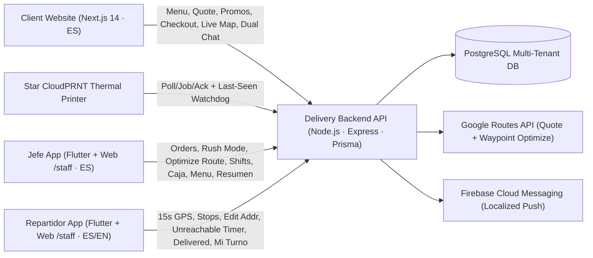
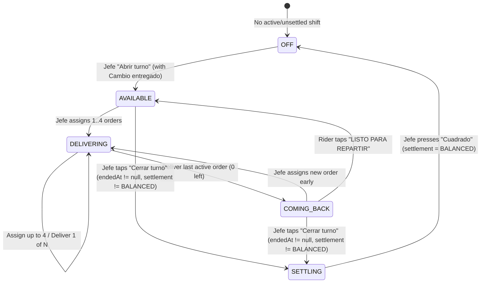

# Private Restaurant Delivery System — Full Functional & Technical Specifications Book

> [!IMPORTANT]
> **100% Commission-Free Multi-Tenant Delivery Platform for Restaurants**
> Replaces 25%–35% aggregator marketplaces with a white-label Spanish ordering website, Spanish fiscal-compliant thermal printing (`Veri*factu`-ready SHA-256 chain & dual `COMANDA` + `FACTURA SIMPLIFICADA`), real-time GPS tracking, and unified **Jefe** & **Repartidor** mobile/web applications — all strictly isolated per tenant via `restaurantId`.

---

## 1. Executive Summary & Value Proposition

| Operational Challenge | Platform Solution |
| :--- | :--- |
| **Marketplace Commissions (25%–35%)** | **0% Commission**: Direct web/phone ordering straight into the kitchen printer and Jefe board. |
| **Tablet Bottlenecks & Missed Orders** | **Auto-Acceptance**: Valid orders immediately enter `IN_KITCHEN` status, queue for CloudPRNT, and trigger push/audio alerts. |
| **Complex Customization & EU Allergen Law** | **Modifiers, Combos & 14 EU Allergens**: Reusable `ModifierGroup`s (required radio / optional multi-select), sequential combo steps (`isCombo`), snapshot item modifiers (`OrderItemModifier`), and EU allergen badges. |
| **Spanish Anti-Fraud & `IVA` Billing (`Veri*factu` / `TicketBAI`)** | **Atomic Sequential Invoicing & SHA-256 Chain**: Per-restaurant annual `invoiceNumber` (`YYYY-NNNNNN`), mixed-rate `IVA` breakdown (`10%`/`21%`/`4%`), deterministic `fiscalHash` chained via `previousInvoiceHash`, and dual CloudPRNT tickets. |
| **Unprofitable Distances, Missing Change & Late Orders** | **Tiered `DeliveryZone`s, `PromoCode`s & Rush Mode Cutoff**: Distance-tiered delivery fees & min-order rules, dynamic `+0`/`+15`/`+30 min` `extraPrepMinutes`, and mandatory cash pay-with change declaration. |
| **Dispatching, Multi-Stop Routing & Unreachable Doors** | **FIFO Rider Queue + Google Routes Optimization + 5-Min Door Timer**: Auto-optimizes `1..4` stops, streams live rider GPS every `15s`, and protects riders with a server-enforced 5-minute `Cliente no contesta` workflow. |
| **Shift Reconciliation & Rider Cash Accountability** | **Closed-Shift `SETTLING` -> `Cuadrado` -> `OFF` Workflow**: After `Cerrar turno`, the rider keeps access to their live `Mi turno` Caja & card list until the Jefe marks it `Cuadrado` (`BALANCED`). Card payments are always listed one-by-one (never summed). |

---

## 2. System Architecture & Multi-Tenant Isolation

Every database table carries `restaurantId` (or derives it cleanly through a parent foreign key), and every authenticated or public query strictly filters by `restaurantId` resolved from the staff JWT or `:slug` / `:token`.

### Repository Structure
- `delivery-backend/delivery-backend/`: Node.js, Express, TypeScript, Prisma ORM (`schema.prisma`, `seed.ts`, `orders.ts`, `maps.ts`, `rules.ts`, `auth.ts`, `push.ts`, `routes/public.ts`, `routes/staff.ts`, `routes/printer.ts`).
- `website/website/`: Next.js 14 App Router (`app/page.tsx` storefront, `app/pedido/[token]/page.tsx` tracking + live map + dual chats + ratings, `app/staff/page.tsx` web Jefe & Repartidor console, `lib/api.ts`).
- `staff_app/staff_app/`: Flutter Android/iOS application (`lib/jefe/jefe_home.dart`, `lib/jefe/manual_order.dart`, `lib/rider/rider_home.dart`, `lib/l10n.dart`, `lib/common.dart`, `lib/ratings.dart`).

---

## 3. Data Model Specification (Prisma Schema)

### 3.1 Core Enums
- `Role`: `OWNER`, `JEFE`, `REPARTIDOR`
- `OrderStatus`: `NEW`, `IN_KITCHEN`, `READY`, `ON_THE_WAY`, `DELIVERED`, `CANCELLED`
- `OrderSource`: `WEB`, `MANUAL`
- `PaymentMethod`: `CASH`, `CARD`
- `Settlement`: `PENDING`, `BALANCED`, `DIFFERENCE`

### 3.2 Tenant, Operations & Fiscal Models
| Model | Key Fields | Purpose |
| :--- | :--- | :--- |
| **`Restaurant`** | `id`, `name`, `slug` (unique), `timezone` (`Europe/Madrid`), `active`, `legalName`, `nifCif`, `fiscalAddress`, `defaultVatRate` (`Decimal(4,2)`, default `10.00`), `printCustomerReceipt` (`true`), `extraPrepMinutes` (`Int`, default `0`), `lastPrinterPollAt` (`DateTime?`) | Multi-tenant root, Spanish fiscal identity, Rush Mode prep delay, CloudPRNT heartbeat timestamp. |
| **`RestaurantSettings`** | `restaurantId` (PK), `city`, `lat`, `lng`, `maxRadiusKm` (`10`), `prepMinutes` (`0`), `graceMinutesAfterClose` (`20`), `dayResetHour` (`2` = `02:00 AM`), `dropoffBufferMinutes` (`2`), `minOrder?`, `deliveryFee` (`0`) | Coordinates, default radius/fee fallback, timing buffers, and `02:00 AM` working-day rollover. |
| **`OpeningHour`** | `id`, `restaurantId`, `weekday` (`0..6`), `openMin` (`Int`), `closeMin` (`Int` up to `1440`) | Weekly schedule per weekday in local restaurant minutes from midnight. |
| **`Printer`** | `id`, `restaurantId`, `name`, `token` (unique), `active`, `lastSeenAt?` | Secret token authenticating Star CloudPRNT endpoints. |
| **`DeliveryZone`** | `id`, `restaurantId`, `name`, `minKm`, `maxKm`, `deliveryFee`, `minOrderAmount`, `isActive` | Distance-tiered fees & minimum order enforcement (falls back to `RestaurantSettings.maxRadiusKm` if none configured). |
| **`PromoCode`** | `id`, `restaurantId`, `code` (unique per restaurant), `discountType` (`PERCENTAGE` \| `FIXED_AMOUNT`), `discountValue`, `minOrderAmount`, `maxUses?`, `usedCount`, `expiresAt?`, `isActive` | Server-validated promo coupons incremented atomically on order creation. |

### 3.3 Menu & Modifier Models
| Model | Key Fields | Purpose |
| :--- | :--- | :--- |
| **`Category`** | `id`, `restaurantId`, `name`, `position` | Ordered menu sections (`Pizzas`, `Kebab`, etc.). |
| **`Product`** | `id`, `restaurantId`, `categoryId?`, `name`, `description?`, `price` (`Decimal(8,2)`), `available`, `allergens` (`String[]`), `isCombo` (`Boolean`), `vatRate` (`Decimal(4,2)`, default `10.00`) | Menu dish with EU allergen list (`14` codes), combo workflow flag, and item-level VAT rate (`10%`/`21%`/`4%`). |
| **`ModifierGroup`** | `id`, `restaurantId`, `name`, `minSelections`, `maxSelections`, `sortOrder` | Reusable option group (`minSelections >= 1` required; `maxSelections === 1` radio vs `> 1` multi-select). |
| **`ModifierOption`** | `id`, `modifierGroupId`, `name`, `priceDelta` (`Decimal(10,2)`), `isAvailable`, `sortOrder` | Option choice with price delta and independent `Disponible`/`Agotado` availability switch. |
| **`ProductModifierGroup`** | `id`, `productId`, `modifierGroupId`, `sortOrder` (unique `[productId, modifierGroupId]`) | Many-to-many ordered assignment reusing groups across dishes. |

### 3.4 Orders, Fiscal Audit, Snapshots & Tracking Models
| Model | Key Fields | Purpose |
| :--- | :--- | :--- |
| **`Order`** | `id`, `restaurantId`, `number` (unique per restaurant), `status`, `source`, `trackingToken` (unique UUID), client & structured Spanish address fields (`streetType`, `streetName`, `streetNumber`, `postalCode`, `floor?`, `door?`, `notes?`), `distanceKm`, `etaMinutes`, `total`, `paymentMethod`, `cashAmount?`, `cancelReason?`, `cancelledById?`, `clientId?`, `repartidorId?`, `stopNumber?`, `printedAt?`, `createdAt`, `deliveredAt?`, `invoiceNumber?`, `netAmount`, `vatAmount`, `vatBreakdown` (`Json`), `fiscalHash?`, `previousInvoiceHash?`, `destLat?`, `destLng?`, `unreachableStartedAt?`, `printFailed` (`Boolean`), `deliveryFee`, `discountAmount`, `promoCode?` | Complete order lifecycle, Spanish fiscal audit ledger, route stop sequence, coordinates, printer failure flag, and unreachable door timer. |
| **`OrderItem`** | `id`, `orderId`, `productId`, `name` (snapshot), `unitPrice` (snapshot), `vatRate` (snapshot), `quantity`, `note?` | Preserves historical unit price (`base + modifiers`) and VAT rate regardless of later menu changes. |
| **`OrderItemModifier`** | `id`, `orderItemId`, `groupName` (snapshot), `optionName` (snapshot), `priceDelta` (snapshot) | Immutable modifier snapshot protecting historical tickets and `Caja` totals. |
| **`OrderEvent`** | `id`, `orderId`, `actorId?`, `type`, `data` (`Json?`), `createdAt` | Full audit log (`CREATED`, `PRINTED`, `READY`, `ASSIGNED`, `REASSIGNED`, `DELIVERED`, `CANCELLED`, `ADDRESS_EDITED`, `UNREACHABLE_ATTEMPT`, `UNREACHABLE_RETURN`). |

### 3.5 Staff, Clients, Shifts, Messaging & Telemetry Models
| Model | Key Fields | Purpose |
| :--- | :--- | :--- |
| **`User`** | `id`, `restaurantId?`, `role`, `name`, `email` (unique), `phone?`, `documentNumber?`, `passwordHash`, `language` (`es`/`en`), `active`, `lastLat?`, `lastLng?`, `lastLocationAt?` | Jefe/Repartidor accounts, DNI/NIE/Passport metadata, and throttled live GPS telemetry. |
| **`Shift`** | `id`, `restaurantId`, `userId`, `startedAt`, `endedAt?`, `changeGiven`, `availableSince?`, `comingBack`, `settlement`, `difference?`, `settlementNote?` | FIFO queue tracking (`availableSince`), trip return lock (`comingBack`), closed-but-unsettled `SETTLING` state, and Jefe `Caja` reconciliation. |
| **`Client`** | `id`, `restaurantId`, `name`, `email` (unique per restaurant), `phone`, `passwordHash`, saved address fields | Customer login (`Mi cuenta`) with auto-populated delivery address & 1-click reorder history. |
| **`ChatMessage`** | `id`, `restaurantId`, `channel` (`STAFF` \| `JEFE_CLIENT` \| `RIDER_CLIENT`), `repartidorId?`, `orderId?`, `senderRole`, `senderName`, `text`, `createdAt` | Strictly separated private chat channels. |
| **`Rating`** | `id`, `restaurantId`, `orderId` (unique), `repartidorId?`, `score` (`1..5`), `comment?`, `createdAt` | One rating per `DELIVERED` order, visible to both Jefe and Repartidores. |
| **`DeviceToken`** | `id`, `userId`, `restaurantId`, `token` (unique), `platform` (`android`/`ios`) | FCM push notification routing transferred on login and removed on logout. |

---

## 4. Module 1 — Client Ordering Website (`website/`)

All customer-facing text is **100% Spanish**, responsive for mobile and desktop.

### 4.1 Menu Display, Allergens, Modifiers & Combos
- **Opening Banner & Rush Mode**: Shows schedule and warns *"Ahora mismo estamos cerrados y no se pueden hacer pedidos"* outside `OpeningHour` intervals; incorporates `restaurant.extraPrepMinutes` (`Modo hora punta`) into live ETAs.
- **14 EU Mandatory Allergens**: Visual badges for `GLUTEN`, `CRUSTACEANS`, `EGGS`, `FISH`, `PEANUTS`, `SOYBEANS`, `MILK`, `NUTS`, `CELERY`, `MUSTARD`, `SESAME`, `SULPHITES`, `LUPIN`, `MOLLUSCS`.
- **Interactive Modifier & Combo Modal**:
  - Single-choice radio buttons when `maxSelections === 1`, checkboxes up to `maxSelections` when `> 1`.
  - Options with `isAvailable === false` display **`Agotado`** and cannot be chosen.
  - Dishes with `isCombo === true` label steps sequentially (`Paso 1`, `Paso 2`, ...).
  - Server re-computes `unitPrice = product.price + sum(selectedOption.priceDelta)` and throws `INVALID_MODIFIERS` or `MODIFIER_UNAVAILABLE` if violated.

### 4.2 Client Accounts (`👤 Mi cuenta`) & Guest Checkout
- Customers may check out seamlessly as **guests** or sign in/register per restaurant slug:
  - Placing an order while logged in persists updated delivery contact/address fields (`Client` record).
  - `Mis pedidos` displays live order status badges, direct tracking links (`/pedido/[token]`), and **🔁 Repetir** (1-click cart reload for unmodified items).

### 4.3 Structured Address Validation, Distance Zones, Promos & Closing Guardrail
- Enforces `streetType` (`calle`, `avenida`, `plaza`, `paseo`, `camino`, `carretera`), 5-digit `postalCode` (`\d{5}`), `streetName`, `streetNumber`, and optional `floor`/`door`/`notes`.
- **Server `Quote` & Checkout Rules** (`POST /public/:slug/quote`, `POST /public/:slug/orders`):
  1. **Zone Match (`DeliveryZone`)**: Matches road `km` from `maps.ts` against `[minKm, maxKm]` tiers to determine `deliveryFee` and check `subtotal >= minOrderAmount` (errors with `OUT_OF_ZONE` or `BELOW_ZONE_MINIMUM`).
  2. **Promo Validation (`PromoCode`)**: Checks uppercase `code`, `isActive`, `expiresAt`, `usedCount < maxUses`, and `subtotal >= minOrderAmount` (`INVALID_PROMO`, `PROMO_EXPIRED`, `PROMO_LIMIT_REACHED`, `PROMO_MIN_ORDER`), capping `discountAmount` at `subtotal`.
  3. **Closing Cutoff**: Requires order timing to satisfy:
     $$\text{Now} + (\text{prepMinutes} + \text{extraPrepMinutes}) + (\text{drivingETA} + \text{dropoffBufferMinutes}) \le \text{closingTime} + \text{graceMinutesAfterClose}$$
     where default `graceMinutesAfterClose = 20`. Throws `RESTAURANT_CLOSED` or `PAST_LAST_ORDER` otherwise.
  4. **Payment Declaration**: `CARD` (portable terminal) or `CASH` with required `cashAmount >= total` (`CASH_AMOUNT_REQUIRED`, `CASH_AMOUNT_TOO_LOW`) to print exact change.

### 4.4 Live Tracking Page (`/pedido/[token]`)
Polls `GET /public/orders/:token` every `10s`:
- Displays sequential fiscal `invoiceNumber`, itemized lines + snapshot modifiers, and status progress (`En cocina` -> `Listo` -> `En camino` -> `Entregado` / `Cancelado` with `cancelReason`).
- **Interactive Live Map (`LiveDeliveryMap`)**: Active during `ON_THE_WAY`, rendering restaurant (`🏪`), customer (`🏠`), and live moving scooter (`🛵`) coordinates (privacy guardrail: `riderLocation` is only returned while `status === 'ON_THE_WAY'` and `lastLocationAt` is `< 2 minutes` old).
- **Unreachable Customer Banner**: Shown immediately if `unreachableStartedAt != null`.
- **Two Strictly Private Chats (with Web Audio Notification Chime)**:
  - **🏪 Chat con el restaurante (`JEFE_CLIENT`)**: Visible only to Customer and Jefe.
  - **🛵 Chat con tu repartidor (`RIDER_CLIENT`)**: Visible only to Customer and assigned Repartidor.
- **Post-Delivery Rating**: 1–5 star score + optional comment allowed once upon `DELIVERED`.

---

## 5. Module 2 — Spanish Fiscal Compliance & Star CloudPRNT (`/printer/:token/*`)

### 5.1 Atomic Fiscal Calculation & `Veri*factu` Hash Chain
Inside `prisma.$transaction` on every order (`createOrder`):
1. Determines next `number` and constructs annual sequential `invoiceNumber` = `${YYYY}-${String(nextNumber).padStart(6, "0")}`.
2. Groups gross item totals (plus taxable delivery fee at `defaultVatRate`) by `vatRate` (`10%`, `21%`, `4%`), proportional after any promo discount, computing exact `base` (`gross / (1 + rate/100)`), `quota` (`gross - base`), `netAmount`, `vatAmount`, and `vatBreakdown` JSON.
3. Links previous order hash (`previousInvoiceHash = prev?.fiscalHash ?? "GENESIS"`) and hashes:
   $$\text{fiscalHash} = \text{SHA256}\big(\texttt{nifCif | invoiceNumber | createdAtISO | total(2dp) | previousInvoiceHash}\big)$$

### 5.2 Dual 42-Column Thermal Ticket (`GET /printer/:token/job`)
When `restaurant.printCustomerReceipt === true`, outputs two distinct sections separated by a double dashed line (`42` characters wide):
1. **`COMANDA DE COCINA`**: Restaurant name, `PEDIDO #N`, date/time, items + indented modifiers (`  + Familiar`) + item notes, payment & cash change line, client contact, structured address, and delivery notes.
2. **`FACTURA SIMPLIFICADA (TICKET CLIENTE)`**: `legalName`, `NIF/CIF`, `fiscalAddress`, `FACTURA: YYYY-NNNNNN`, itemized prices + modifier deltas (`(+3.50 EUR)`), delivery fee / promo discount lines, **`DESGLOSE DE IVA`** per rate (`IVA X%  Base ...  Cuota ...`), `BASE IMPONIBLE`, `TOTAL IVA`, `TOTAL (IVA INCL.)`, payment summary, and `Veri*factu SHA-256: <16-char prefix>`.

### 5.3 CloudPRNT Protocol & Hardware Watchdog
- Printer polls `POST /printer/:token/poll` -> receives `{ jobReady, mediaTypes: ["text/plain"], jobToken }`. Both `Printer.lastSeenAt` and `Restaurant.lastPrinterPollAt` update on every poll/job/delete call.
- **Offline Watchdog (`> 45s`)**: `GET /staff/restaurant/status` marks `printerOffline = true` when the restaurant is open and `now - lastPrinterPollAt > 45_000`.
- **Unprinted Job Watchdog (`> 60s`)**: Running `GET /orders` as `JEFE` flags any `IN_KITCHEN` order older than `60s` with `printedAt == null` as `printFailed: true`, creates an `UNPRINTED_ALERT` event, sends urgent FCM push to all Jefes, and triggers persistent red alert banners + alarm audio on Jefe clients until printed (`DELETE /printer/:token/job`) or reprinted.

---

## 6. Module 3 — Jefe (Manager) Operations Center (`staff_app` & `/staff`)

Spanish-only interface organized into **6 tabs** (`Pedidos`, `Repartidores`, `Caja`, `Menú`, `Valoraciones`, `Resumen`):

### 6.1 `Pedidos` Tab & Manual Phone Orders
- **Rush Mode Header (`Modo hora punta`)**: Quick toggles (`Prep: Normal`, `+15 min`, `+30 min`) updating `PATCH /staff/restaurant/prep-delay`.
- **Watchdog Bar**: Live CloudPRNT connectivity badge and one-click `Reimprimir` alerts for unprinted `> 60s` jobs.
- **Multi-Stop Dispatch & Route Optimization (`max = 4`, `RIDER_FULL`)**:
  - `Asignar` picker lists active non-settling riders with live load (`0..4`) and **`★`** highlighting the longest-waiting `AVAILABLE` rider (FIFO queue).
  - Assigning a 2nd–4th order automatically runs `optimizeRiderStops()` via Google Routes API `computeRoutes` (`optimizeWaypointOrder: true`, nearest-neighbor geographic fallback when Maps key is absent or in mock mode).
  - Active rider trip cards (`>= 2` `ON_THE_WAY` orders) offer **`🗺️ Ordenar ruta óptima`** (`POST /staff/riders/:riderId/optimize-route`) and manual **`Reordenar`** (`POST /staff/riders/:riderId/reorder-stops`).
- **Order Cards**: Display `#number`, `invoiceNumber`, `Parada 1..N`, snapshot modifiers, unreachable door alerts (with Jefe override **`Devolver a tienda`**), `Listo`, `Reimprimir`, `Asignar`/`Reasignar`, private **`JEFE_CLIENT`** chat, and `Cancelar` (with required reason).
- **＋ Pedido manual**: Full structured client & address form + modifier modal + EU allergen pills + `promoCode` input; bypasses opening-hours cutoff (`enforceRules = false`) while strictly validating modifiers, server prices, promo codes, and delivery zones.

### 6.2 `Repartidores` Tab (Roster, Onboarding, Internal Chat & Shift Control)
- Create riders (`＋ Nuevo repartidor` -> `POST /staff/riders`), edit `name` / `documentNumber` (DNI/NIE/Passport) / `phone`, open 1-to-1 **`STAFF`** chat (`💬`), open shifts (`Abrir turno` with `changeGiven`), and close shifts (`Cerrar turno` blocked with `RIDER_HAS_ORDERS` if active orders > 0).
- After closing a shift (`Cerrar turno`), the rider row displays **`pendiente de cuadrar caja`** with an **`Ir a Caja` / `Cuadrar en Caja`** shortcut until the shift is settled as `BALANCED` (`Cuadrado`), at which point it transitions to **`Fuera de turno`** with **`Abrir turno`** available.

### 6.3 `Caja` Tab (Working-Day Ledger & Settlement Lifecycle)
- Shows all shifts from the current working day (rolling over at `02:00 AM`, `dayResetHour = 2`) plus any older unsettled shifts (`settlement === 'PENDING'`).
- Displays: `Entregas`, `Efectivo cobrado`, `Cambio entregado`, **`Efectivo a recibir` (`cashCollected + changeGiven`)**, and **`Pagos con tarjeta` listed one by one (`#2 — 16.50 €`, NEVER summed)** to match datáfono slips.
- Settlement actions: **Cuadrado** (`BALANCED`, transitioning the rider cleanly to `Fuera de turno`) or **Con diferencia** (`DIFFERENCE` with signed amount & note); once settled, **Corregir** allows reopening edits.

### 6.4 `Menú` Tab
- **Modifier Groups & Options CRUD**: Create/delete groups (`minSelections`, `maxSelections`), add options (`priceDelta`), and toggle per-option **`Disponible` / `Agotado`**.
- **Categories & Products CRUD**: Edit categories, dishes (`name`, `description`, `price`, `vatRate` `10%`/`21%`/`4%`, `isCombo`, `allergens` 14 EU toggles, `modifierGroupIds`), and toggle dish availability (`Disponible`/`Agotado`) immediately across web and manual orders.

### 6.5 `Resumen` & `Valoraciones` Tabs
- **`Resumen`**: Sales & Operations Analytics (`GET /staff/analytics?from=&to=`: `grossRevenue`, `netAmount`, `vatAmount`, `orderCount`, `averageTicket`, cash vs. card split, `avgPrepMinutes`, `avgDeliveryMinutes`, `topProducts`, `deliveriesByRider`), editable Spanish Fiscal Identity (`PATCH /staff/restaurant/fiscal`), `DeliveryZone` manager, and `PromoCode` manager.
- **`Valoraciones`**: Overall average rating (`★`) and customer review feed with order number and rider name.

---

## 7. Module 4 — Repartidor (Rider) Interface (Bilingual `ES` / `EN`)

Instant UI and push-notification language switching between **Español (`es`)** and **English (`en`)**.

### 7.1 Rider Shift State Machine (`SETTLING` Preserves Rider Caja Until `Cuadrado`)

- **Key Invariant**: Calling `POST /shifts/:id/close` sets `endedAt`, stopping new order dispatch (`openShift` is null) and marking the rider `SETTLING` (`"Turno cerrado — Pendiente de cuadrar caja"`). Because `GET /me/shift` and `GET /me/summary` query `currentRiderShift` (`endedAt: null OR settlement != "BALANCED"`), the rider keeps full access to their **`Mi turno`** Caja breakdown (`Efectivo cobrado`, `Cambio recibido`, `Efectivo a entregar`, individual `Pagos con tarjeta`) and **`Historial de entregas`** to perform calculations until the Jefe presses **Cuadrado** (`settlement = "BALANCED"`), turning both views to **`Fuera de turno`** (`OFF`).

### 7.2 Live GPS, Multi-Stop Cards & Unreachable 5-Minute Timer
- **Throttled GPS Telemetry**: While `status === 'DELIVERING'` (`orders.length > 0`), sends `PATCH /staff/riders/me/location` (`{ lat, lng }`) every `15` seconds, stopping immediately upon entering `COMING_BACK`, `SETTLING`, or `OFF`.
- **Action Bar per Card (`Parada 1..4`)**:
  - Copiable full structured address & phone number.
  - Itemized dish list with indented modifiers (`+ Familiar`, `+ Extra queso`).
  - Cash change calculation (`Total · Efectivo · paga con X · cambio Y`).
  - **📍 Mapa / Map**: Copies `<streetType> <streetName> <streetNumber>, <postalCode>` (including postal code, omitting floor/door for accurate geocoding) and launches Google Maps.
  - **📞 Llamar / Call** & **✏️ Editar dirección / Edit address** (recalculates road `distanceKm`, `etaMinutes`, and `destLat`/`destLng` on the server).
  - **💬 Chat cliente / Client chat** (`RIDER_CLIENT`, private from Jefe) & **💬 Chat Jefe** (`STAFF`).
- **⏱ `Cliente no contesta` (`unreachableStartedAt`)**:
  1. Tapping **`Cliente no contesta`** calls `POST /orders/:id/unreachable`, sets `unreachableStartedAt`, sends urgent FCM push to Jefe, and posts `"Tu repartidor está en la puerta y no logra contactar contigo. Por favor, responde en los próximos 5 minutos."` in the customer's `RIDER_CLIENT` chat.
  2. Shows a live `05:00 -> 00:00` countdown timer.
  3. Server blocks `POST /orders/:id/unreachable-return` with `WAIT_5_MINUTES` until `300` seconds have elapsed for riders (Jefe can trigger immediately); once unlocked, marks the order `CANCELLED` with `"Incidencia: cliente no contesta (devuelto a tienda)"` and triggers `refreshRider()`.

---

## 8. Complete REST API & Error Reference

### 8.1 Public Endpoints (`publicRoutes`)
| Method & Path | Purpose |
| :--- | :--- |
| `GET /health` | Service health check (`{ ok: true }`). |
| `GET /public/:slug/menu` | Restaurant open status, `extraPrepMinutes`, active `deliveryZones`, `hours`, categories, available products, `allergens`, `isCombo`, `vatRate`, and `modifierGroups`. |
| `POST /public/:slug/quote` | Evaluates road `distanceKm`, `deliveryFee`, zone `minOrderAmount`, promo `discountAmount`, closing cutoff, and `etaMinutes`. |
| `POST /public/:slug/orders` | Guest or client-authenticated order creation returning `{ trackingToken, number, etaMinutes, total }`. |
| `POST /public/:slug/clients/register`, `/login` | Client account creation and authentication (`JWT`). |
| `GET / PATCH /public/:slug/clients/me` | Saved client address profile and past/live order history with items. |
| `GET /public/orders/:token` | Tracking status, `invoiceNumber`, items/modifiers, `unreachableStartedAt`, and live GPS pins (strictly when `ON_THE_WAY` & `< 2m` fresh). |
| `GET / POST /public/orders/:token/messages` | Private `JEFE_CLIENT` or `RIDER_CLIENT` chat messages. |
| `POST /public/orders/:token/rating` | One-time post-delivery star rating (`1..5`) + comment. |

### 8.2 CloudPRNT Endpoints (`printerRoutes`)
| Method & Path | Purpose |
| :--- | :--- |
| `POST /printer/:token/poll` | Updates `Printer.lastSeenAt` + `Restaurant.lastPrinterPollAt`; returns `{ jobReady, jobToken }`. |
| `GET /printer/:token/job` | Returns 42-col plain-text `COMANDA DE COCINA` + `FACTURA SIMPLIFICADA` (if `printCustomerReceipt`). |
| `DELETE /printer/:token/job` | Sets `printedAt = now()`, clears `printFailed: false`, logs `PRINTED`. |

### 8.3 Staff Endpoints (`staff` — JWT Roles: `JEFE`, `REPARTIDOR`)
| Group | Endpoints |
| :--- | :--- |
| **Auth & Profile** | `POST /auth/login`, `POST /me/device`, `POST /me/device/remove`, `POST /me/language` |
| **Orders & Routing** | `GET /orders`, `POST /orders` (manual phone order), `POST /orders/:id/ready`, `POST /orders/:id/assign`, `POST /orders/:id/delivered`, `PATCH /orders/:id/address`, `POST /orders/:id/reprint`, `POST /orders/:id/cancel`, `POST /orders/:id/unreachable`, `POST /orders/:id/unreachable-return`, `POST /staff/riders/:riderId/optimize-route`, `POST /staff/riders/:riderId/reorder-stops`, `PATCH /staff/riders/me/location` |
| **Riders & Shifts** | `GET /riders`, `GET /staff/riders`, `POST /staff/riders`, `PATCH /staff/riders/:id`, `GET /me/shift`, `POST /me/ready`, `GET /me/summary`, `GET /shifts`, `POST /shifts/open`, `POST /shifts/:id/close`, `POST /shifts/:id/settle`, `GET /shifts/:id/summary` |
| **Menu & Modifiers** | `GET /menu`, `POST/PATCH/DELETE /menu/categories`, `POST/PATCH/DELETE /menu/products`, `GET/POST/PATCH/DELETE /menu/modifier-groups`, `POST/PATCH/DELETE /menu/modifier-options` |
| **Operations, Fiscal & Analytics** | `GET /staff/restaurant/status`, `PATCH /staff/restaurant/prep-delay`, `PATCH /staff/restaurant/fiscal`, `POST /restaurant/hours`, `GET/POST/DELETE /staff/zones`, `GET/POST/DELETE /staff/promos`, `GET /staff/analytics`, `GET /ratings` |
| **Private Messaging** | `GET/POST /chat/staff/:riderId`, `GET/POST /orders/:id/messages`, `GET /chat/inbox` |

### 8.4 Canonical Domain Error Codes
- **Orders & Modifiers**: `EMPTY_ORDER`, `PRODUCT_UNAVAILABLE`, `INVALID_MODIFIERS`, `MODIFIER_UNAVAILABLE`, `CASH_AMOUNT_REQUIRED`, `CASH_AMOUNT_TOO_LOW`
- **Zones, Hours & Promos**: `ADDRESS_NOT_FOUND`, `OUT_OF_ZONE`, `BELOW_ZONE_MINIMUM`, `RESTAURANT_CLOSED`, `PAST_LAST_ORDER`, `INVALID_PROMO`, `PROMO_EXPIRED`, `PROMO_LIMIT_REACHED`, `PROMO_MIN_ORDER`
- **Dispatch, Shifts & State**: `INVALID_STATUS`, `NOT_YOUR_ORDER`, `RIDER_NOT_ON_SHIFT`, `RIDER_FULL` (`4` max), `RIDER_HAS_ORDERS`, `SHIFT_ALREADY_OPEN`, `NOT_COMING_BACK`, `WAIT_5_MINUTES` (`300s`), `NOT_DELIVERED`, `ALREADY_RATED`
- **Auth**: `INVALID_CREDENTIALS`, `EMAIL_TAKEN`, `RESTAURANT_UNAVAILABLE`, `VALIDATION`
