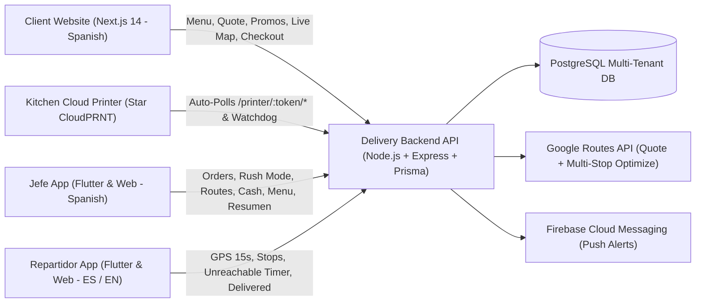

# Private Restaurant Delivery System — Commercial & Functional Specifications Book

> [!IMPORTANT]
> **100% Commission-Free Direct Delivery Platform for Restaurants**
> Designed to replace third-party marketplaces (30% commission fees) with a restaurant-owned ordering website, Spanish fiscal-compliant kitchen & customer printing (`Veri*factu`-ready), live GPS delivery tracking, and a unified mobile/web operations suite for the **Jefe (Manager)** and **Repartidores (Riders)**.

---

## 1. Executive Summary & Value Proposition (Why Restaurant Owners Buy It)

| Pain Point with Aggregators / Phone Orders | How This Platform Solves It |
| :--- | :--- |
| **25%–35% commission per order** on third-party apps | **0% commission**: orders flow directly from the restaurant's website into the kitchen printer and Jefe board. |
| **Customizable pizzas, kebabs, combos & EU allergen laws** | **Reusable Modifier Groups, Combos & 14 EU Allergens**: required sizes/meats, optional extras, combo steps, snapshot pricing (`OrderItemModifier`), and clear EU allergen badges on every dish. |
| **Spanish Fiscal Compliance & anti-fraud invoicing** | **Automated `Factura Simplificada` & `Veri*factu` Hash Chain**: yearly sequential `invoiceNumber` (`YYYY-NNNNNN`), per-rate `IVA` breakdown (`10%` / `21%` / `4%`), and tamper-evident SHA-256 chain (`fiscalHash` + `previousInvoiceHash`). |
| **Out-of-zone, tiered fees, or late-night orders after kitchen close** | **Tiered `DeliveryZone`s, `PromoCode`s & Dynamic Rush Mode Guardrail**: road driving distance (`km`), min-order enforcement, coupon discounts, and dynamic `+15`/`+30 min` prep delay (`extraPrepMinutes`) factored into quotes and the `Closing + 20 min` cutoff. |
| **Multi-stop dispatching & "where is my order?" calls** | **Google Routes Optimization + Live Rider GPS**: auto-optimizes 2–4 stops (`Ordenar ruta óptima`), streams rider GPS every 15s during `ON_THE_WAY` to `/pedido/[token]`, and enforces a 5-minute unreachable-client timer. |
| **Riders arriving without enough change** | **Mandatory cash declaration**: cash clients declare the exact bill they pay with (`¿Con cuánto vas a pagar?`), calculating exact change on the ticket and rider screen. |
| **End-of-night cash & card reconciliation chaos** | **Shift-based cash ledger (`Caja`)**: tracks initial change float, cash collected, net cash due, and lists **card payments individually (never summed)** alongside a `Resumen` analytics dashboard. |

---

## 2. System Architecture Overview

The platform consists of **four integrated modules** backed by a multi-tenant PostgreSQL database (strict `restaurantId` isolation on every model, query, and mutation):

---

## 3. Module 1 — Client Ordering Website (`website/`)

**Target User:** Hungry customers ordering from phone or desktop (100% Spanish, supporting **zero-friction Guest Checkout** and **Client Accounts (`👤 Mi cuenta`)** with saved addresses, order history, and 1-click reorder).

### 3.1 Client Account System (`👤 Mi cuenta`) & Guest Checkout
- **Optional 1-Click Account (`Iniciar sesión` / `Crear cuenta`)**:
  - **Auto-Filled Delivery Address**: Populates and remembers habitual name, phone, street, number, postal code, floor, door, and delivery notes.
  - **`Mis pedidos` (Live Order History)**: Lists past/active orders with live status, links to `/pedido/[token]`, and **`🔁 Repetir`** to reload items in one click.
- **Guest Checkout**: Direct checkout without mandatory account creation.

### 3.2 Live Menu, EU Allergens, Modifiers & Combos
- **Live Open/Closed & Rush Mode Banner**: Outside opening hours, disables checkout with a clear notice; shows current delivery schedule and active prep time (including Jefe Rush Mode `+15`/`+30 min`).
- **14 EU Mandatory Allergens**: Each dish clearly badges any configured EU allergens (`GLUTEN`, `CRUSTACEANS`, `EGGS`, `FISH`, `PEANUTS`, `SOYBEANS`, `MILK`, `NUTS`, `CELERY`, `MUSTARD`, `SESAME`, `SULPHITES`, `LUPIN`, `MOLLUSCS`).
- **Product Modifiers & Multi-Step Combos (`isCombo`)**:
  - Dishes with assigned `ModifierGroup`s open an interactive selector modal enforcing `minSelections` (radio single-choice when `maxSelections == 1`, checkboxes when `> 1`).
  - Combos present sequential steps (e.g., Main, Side, Drink).
  - Unit prices and totals (`product.price + sum(option.priceDelta)`) are re-validated strictly server-side, excluding any `Agotado` (`isAvailable = false`) options.

### 3.3 Structured Spanish Address, Distance Zones, Promos & Real-Time Quote
- Enforces structured Spanish address fields (`Tipo de vía`, 5-digit `Código postal`, `Nombre de la vía`, `Número`, optional `Planta`/`Puerta`, and rider notes).
- Live `POST /public/:slug/quote` evaluates:
  1. **Radius & Distance Zones (`DeliveryZone`)**: Matches driving distance (`km`) against configured `[minKm, maxKm]` tiers to compute `deliveryFee` and verify `minOrderAmount`.
  2. **Promo Codes (`PromoCode`)**: Validates active coupons (`PERCENTAGE` or `FIXED_AMOUNT`, minimum order, expiry date, max uses) and displays itemized discount.
  3. **Closing Cutoff with Rush Mode**: Ensures `Now + basePrepMinutes + extraPrepMinutes + drivingETA + dropoffBuffer <= Closing + 20 min`.
  4. **Payment on Delivery**: `CARD` (portable terminal) or `CASH` with mandatory pay-with bill amount (`>= Total`) so exact change is prepared.

### 3.4 Private Live Tracking Map, Dual Private Chats & Verified Ratings (`/pedido/[token]`)
- Refreshes automatically every 10 seconds and displays `invoiceNumber` alongside itemized modifier lines:
  - **Step 1 (`IN_KITCHEN`)**: *"Estamos preparando tu pedido"*
  - **Step 2 (`READY`)**: *"Tu pedido está listo y esperando repartidor"*
  - **Step 3 (`ON_THE_WAY`)**:
    - **Interactive Live Map**: Shows restaurant pin (`🏪`), customer destination pin (`🏠`), and live moving rider scooter pin (`🛵`) sourced from the rider's 15-second GPS updates (only exposed while `status === 'ON_THE_WAY'` and `< 2 min` fresh).
    - **Unreachable Customer Warning**: If the rider triggers *"Cliente no contesta"*, surfaces an urgent banner and automated chat alert with a 5-minute response window.
    - **Two Strictly Private Live Chat Tabs** with notification chimes:
      1. **🏪 Chat privado con el restaurante (`JEFE_CLIENT`)**: Private between Customer and Jefe.
      2. **🛵 Chat privado con tu repartidor (`RIDER_CLIENT`)**: Private between Customer and assigned Repartidor.
  - **Step 4 (`DELIVERED`)**: Unlocks **1–5 Star Rating + Comment** once per order.

---

## 4. Module 2 — Spanish Fiscal Compliance & Star CloudPRNT (`/printer/:token/*`)

**Target Hardware:** Network/Cloud thermal receipt printers (Star CloudPRNT polling `POST /poll`, `GET /job`, `DELETE /job`).

### 4.1 Spanish `Veri*factu`-Ready Fiscal Engine
- **Restaurant Fiscal Identity**: Stores `legalName`, `nifCif`, `fiscalAddress`, `defaultVatRate` (`10.00%` default hospitality), and `printCustomerReceipt`.
- **Sequential Annual Invoicing**: Atomically assigns `invoiceNumber` (`YYYY-NNNNNN` per restaurant per calendar year) inside the creation transaction.
- **Per-Rate `IVA` Breakdown**: Calculates `netAmount`, `vatAmount`, and `vatBreakdown` JSON (`{ rate, base, quota }`) supporting mixed VAT rates (`10%`, `21%`, `4%`).
- **Tamper-Evident Hash Chain**: Computes deterministic SHA-256 `fiscalHash` over `(nifCif + invoiceNumber + createdAtISO + totalAmount + previousInvoiceHash)` linking every order to the prior invoice for that restaurant.

### 4.2 Dual-Receipt 42-Col CloudPRNT Output & Watchdog
- **Section 1 — `COMANDA DE COCINA`**: Order `#Number`, timestamp, items with indented modifiers (`  + Familiar`, `  + Extra queso`), notes, address, and payment instructions (cut command `ESC/POS GS V 66 0` when dual-receipt is enabled).
- **Section 2 — `FACTURA SIMPLIFICADA (TICKET CLIENTE)`**: Restaurant `legalName`, `nifCif`, `fiscalAddress`, `invoiceNumber`, itemized lines with modifier price deltas, `DESGLOSE DE IVA` (`Base Imponible` + `IVA`), `TOTAL (IVA INCL.)`, payment/change summary, and truncated `Veri*factu` SHA-256 hash.
- **Printer Watchdog**: Updates `Restaurant.lastPrinterPollAt` on every `POST /printer/:token/poll`, flags `printerOffline` when open and silent `> 45s`, and runs a 30-second background check flagging `printFailed: true` + sending urgent FCM alerts to the Jefe if any `IN_KITCHEN` ticket remains unprinted after `> 60s`.

---

## 5. Module 3 — Jefe (Manager) Operations Center (`staff_app` & `/staff`)

The Jefe interface (`Spanish-only`) now provides **6 dedicated tabs** (`Pedidos`, `Repartidores`, `Caja`, `Menú`, `Valoraciones`, `Resumen`):

### 5.1 Tab 1: `Pedidos` (Rush Mode, Watchdog, Route Optimization & Manual Orders)
- **Dynamic Rush Mode Bar**: One-tap header pills (`Prep: Normal`, `+15 min`, `+30 min`) updating `extraPrepMinutes` live across website quotes and cutoff checks.
- **Printer Watchdog Banner**: Displays real-time CloudPRNT connectivity and urgent red alerts with one-click **Reimprimir** for any order unprinted `> 60s`.
- **Multi-Stop Route Optimization**: Automatically runs `optimizeWaypointOrder` when assigning a 2nd–4th active order to a rider, plus manual **`🗺️ Ordenar ruta óptima`** and **`Reordenar`** (fallback stop sequence control) buttons whenever a rider has 2–4 `ON_THE_WAY` orders.
- **Live Order Cards**: Display `invoiceNumber`, snapshot item modifiers, `Parada 1..4` pill, unreachable status + immediate Jefe **`Devolver a tienda`** action, `Listo`, `Reimprimir`, `Asignar`/`Reasignar`, and `Cancelar`.
- **＋ Pedido manual**: Full phone-order entry supporting product modifier selection modals, EU allergen display, promo code field, and closing-hours bypass.

### 5.2 Tab 2: `Repartidores` (Roster, Onboarding, Internal Chat & Shifts)
- Onboard riders (`＋ Nuevo repartidor`), edit `Nombre` / `DNI-NIE-Pasaporte` / `Teléfono`, open 1-to-1 `STAFF` chat, open shifts with initial float (`Cambio entregado`), and close shifts (`RIDER_HAS_ORDERS` guard).

### 5.3 Tab 3: `Caja` (Shift Cash & Card Settlement)
- Working day cutoff at `02:00 AM`, exact cash due (`Efectivo cobrado + Cambio entregado`), **individual card payment lines (never summed)**, and `Cuadrado` / `Con diferencia` / `Corregir` settlement workflow.

### 5.4 Tab 4: `Menú` (Modifiers, Allergens, Combos & Catalog)
- **Modifier Groups & Options CRUD**: Create/delete reusable `ModifierGroup`s (`minSelections`, `maxSelections`), add options (`priceDelta`), and toggle **`Disponible` / `Agotado`** per option.
- **Enhanced Dish Editor**: Configure category, price, `IVA %` (`10%`, `21%`, `4%`), `Es un Combo`, multi-select 14 EU allergens, and assigned modifier groups.

### 5.5 Tab 5: `Valoraciones`
- Average score and customer review feed per order and rider.

### 5.6 Tab 6: `Resumen` (Analytics, Fiscal Config, Delivery Zones & Promo Codes)
- **Working-Day KPIs (`GET /staff/analytics`)**: Gross revenue, net base, total `IVA`, order count, average ticket, cash vs. card split, average kitchen prep time (`avgPrepMinutes`), average delivery time (`avgDeliveryMinutes`), top 5 products, and deliveries per rider.
- **Fiscal Settings Editor**: Update `legalName`, `nifCif`, `fiscalAddress`, `defaultVatRate`, and dual-receipt toggle (`PATCH /staff/restaurant/fiscal`).
- **Delivery Zones Manager**: Create/delete distance tiers (`minKm`, `maxKm`, `deliveryFee`, `minOrderAmount`).
- **Promo Codes Manager**: Create/delete `PERCENTAGE` or `FIXED_AMOUNT` coupons with minimum order rules.

---

## 6. Module 4 — Repartidor (Rider) Interface (Bilingual: Español & English)

### 6.1 State Machine, 15s Live GPS & Multi-Stop Sequence
- **States**: `OFF` → `AVAILABLE` (FIFO Queue) → `DELIVERING` (`1..4` stops) → `COMING_BACK` → `AVAILABLE`.
- **Throttled Live GPS Telemetry**: Automatically transmits `PATCH /staff/riders/me/location` every 15 seconds strictly while in `DELIVERING` (`ON_THE_WAY` orders > 0) and stops immediately upon transitioning to `COMING_BACK` or `OFF`.

### 6.2 Delivery Cards, Modifiers & Unreachable Customer 5-Minute Timer
- Shows stop sequence (`Parada 1..4`), itemized lines with indented modifiers, copiable street & phone, cash change calculation, Google Maps deep-link (with postal code copied), Phone call, Structured Address editor, and private Client Chat (`RIDER_CLIENT`).
- **⏱ `Cliente no contesta` Workflow**:
  1. Tapping **`Cliente no contesta`** calls `POST /orders/:id/unreachable`, records `unreachableStartedAt`, sends an urgent FCM alert to the Jefe, and posts an automated 5-minute notice in the customer's tracking chat.
  2. Displays a live `05:00 -> 00:00` countdown on the order card.
  3. After 5 minutes (enforced server-side with `WAIT_5_MINUTES` for riders), unlocks **`Marcar incidencia / Devolver a tienda`** so the rider can continue their remaining stops without unfair cash liability.

### 6.3 `Mi turno` & `Historial de entregas`
- Shows current shift cash accountability, individual card payments, and current shift completed deliveries (resetting cleanly on new shift).
