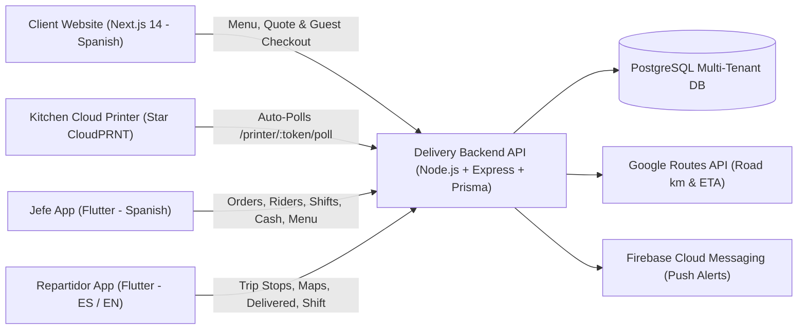
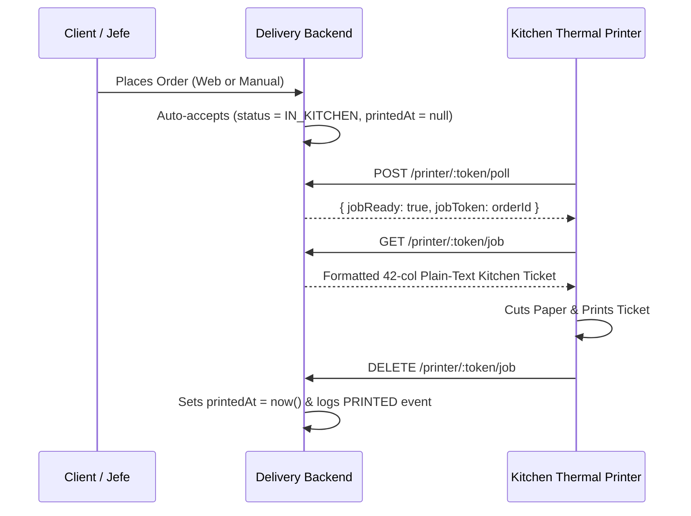
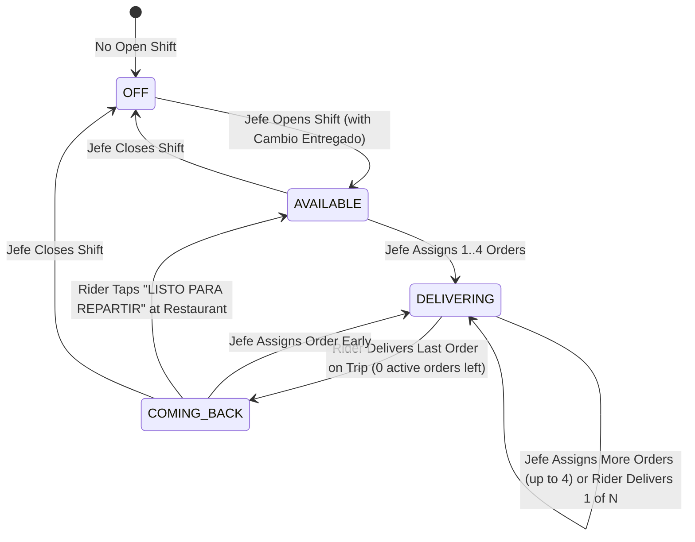

# Private Restaurant Delivery System — Commercial & Functional Specifications Book

> [!IMPORTANT]
> **100% Commission-Free Direct Delivery Platform for Restaurants**
> Designed to replace third-party marketplaces (30% commission fees) with a restaurant-owned ordering website, automated kitchen ticket printing, and a unified mobile app for the **Jefe (Manager)** and **Repartidores (Riders)**.

---

## 1. Executive Summary & Value Proposition (Why Restaurant Owners Buy It)

| Pain Point with Aggregators / Phone Orders | How This Platform Solves It |
| :--- | :--- |
| **25%–35% commission per order** on third-party apps | **0% commission**: orders go straight from the restaurant's own website to the kitchen printer. |
| **Time wasted accepting web orders on a tablet** | **Auto-accepted orders**: valid orders print immediately on the kitchen thermal printer and notify the Jefe's phone. |
| **Out-of-zone or late-night orders after kitchen close** | **Automated road-distance & closing-cutoff guardrails**: checks real driving distance (`km`) and ensures `Order Time + Prep + Travel <= Closing + Grace (20 min)`. |
| **Riders arriving without enough change** | **Mandatory cash declaration**: cash clients enter the exact bill/amount they will pay with (`¿Con cuánto vas a pagar?`), printing the exact change required on the ticket and rider screen. |
| **End-of-night cash & card reconciliation chaos** | **Shift-based cash ledger (`Caja`)**: tracks initial change given (`Cambio entregado`), cash collected, total cash due (`Efectivo a recibir`), and lists **card payments one by one (never summed)** to match physical card terminal slips. |
| **Fair rider dispatch & multi-order trips** | **FIFO Rider Queue (`★` Suggested Rider)** with up to **4 stops per trip**, live rider status (`Disponible`, `Repartiendo`, `Volviendo`), and instant reassignment. |

---

## 2. System Architecture Overview

The platform consists of **four integrated modules** backed by a multi-tenant cloud database (every table isolated by `restaurantId` so a single deployment can serve one pizzeria today and scale to dozens of licensed restaurants tomorrow):

---

## 3. Module 1 — Client Ordering Website (`website/`)

**Target User:** Hungry customers ordering from their phone or computer (100% Spanish, supporting both **zero-friction Guest Checkout** and **Client Accounts (`👤 Mi cuenta`)** with saved addresses, order history, and 1-click reorder).

### 3.1 Client Account System (`👤 Mi cuenta`) & Guest Checkout
- **Optional 1-Click Account (`Iniciar sesión` / `Crear cuenta`)**:
  - **Auto-Filled Delivery Address**: Automatically populates and updates the customer's habitual name, phone, street, number, postal code, floor, door, and delivery notes.
  - **`Mis pedidos` (Live Order History)**: Lists past and active orders with live status (`En cocina`, `Listo`, `En camino`, `Entregado`), direct links to the tracking/chat page (`/pedido/[token]`), and a **`🔁 Repetir`** button that reloads the exact items into the cart in one click.
- **Guest Checkout**: Customers who prefer not to register can still order directly without creating an account.

### 3.2 Live Menu & Opening Hours Banner
- Displays the restaurant's name, daily schedule (`13:00 a 00:00`), and **"Reparto a domicilio gratis"** (free delivery, no minimum order).
- **Live Open/Closed Detection**: Outside opening hours, displays a clear warning banner (*"Ahora mismo estamos cerrados y no se pueden hacer pedidos"*) and disables the checkout button.
- **Instant Menu Updates**: Categories (`Pizzas`, `Kebab`, `Bebidas`, etc.), dishes, descriptions, prices, and availability toggles edited by the Jefe in the mobile app update immediately on the website.

### 3.2 Structured Spanish Address & Real-Time Pre-Check (`Quote`)
- Prevents incomplete or unfindable addresses by enforcing structured fields:
  - **Tipo de vía**: `calle`, `avenida`, `plaza`, `paseo`, `camino`, `carretera`
  - **Código postal**: 5-digit validation
  - **Nombre de la vía** & **Número** (required)
  - **Planta** & **Puerta** (optional)
  - **Notas para el repartidor** (optional, e.g., *"llámame al llegar / no llames al timbre"*)
- As soon as the customer types the street, number, and postal code, the website automatically checks:
  1. **Delivery Zone**: Is the road driving distance within the restaurant's maximum radius (`maxRadiusKm`, default 10 km)?
  2. **Closing Cutoff**: Will `Now + Preparation Time + Driving ETA + Drop-off Buffer` arrive before `Closing Time + 20 min grace`?
  3. **Live ETA Display**: Shows *"Tiempo estimado de entrega: unos X minutos"* before the customer even clicks submit.

### 3.3 Payment on Delivery (Cash with Change Preparation or Card)
- **Tarjeta (`CARD`)**: Rider brings the portable card terminal (datáfono).
- **Efectivo (`CASH`)**: Customer must enter **¿Con cuánto vas a pagar? (€)** (must be `>= Total`). The system automatically calculates the exact change the rider must carry.

### 3.4 Private Live Tracking & Verified Post-Delivery Ratings (`/pedido/[token]`)
- After placing an order, the customer is redirected to a private tracking URL (`/pedido/<trackingToken>`) that refreshes automatically every 10 seconds:
  - **Step 1 (`IN_KITCHEN`)**: *"Estamos preparando tu pedido"* + estimated travel time.
  - **Step 2 (`READY`)**: *"Tu pedido está listo y esperando repartidor"*.
  - **Step 3 (`ON_THE_WAY`)**: *"Tu pedido va en camino"* + **Rider's First Name** + **Estimated Arrival Minutes** + **Two Strictly Private Live Chat Tabs** with audio notification chimes on incoming messages:
    1. **🏪 Chat privado con el restaurante (`JEFE_CLIENT`)**: Private between the customer and the Jefe (the repartidor cannot see these messages).
    2. **🛵 Chat privado con tu repartidor (`RIDER_CLIENT`)**: Private between the customer and the assigned repartidor (the Jefe cannot see these messages).
  - **Step 4 (`DELIVERED`)**: Unlocks a **1 to 5 Star Rating + Comment** form (one rating per delivered order, visible to both Jefe and Repartidores).
  - **If Cancelled (`CANCELLED`)**: Displays the exact cancellation reason entered by the Jefe.

---

## 4. Module 2 — Automated Kitchen Ticket Printer (`/printer/:token/*`)

**Target Hardware:** Network/Cloud thermal receipt printers (Star CloudPRNT protocol).

- **Zero Human Intervention**: Orders are auto-accepted into `IN_KITCHEN` status and queued for printing immediately.
- **Complete Ticket Format**: Prints Restaurant Name, Order `#Number`, local timestamp, item quantities + notes, `TOTAL`, payment method (`TARJETA` or `EFECTIVO - paga con X EUR (cambio Y EUR)`), client name, phone, structured address, and delivery notes.
- **One-Tap Reprint**: The Jefe can tap **Reimprimir** on any order in the app to re-queue the kitchen ticket.

---

## 5. Module 3 — Jefe (Manager) Mobile Interface (Spanish Only)

The Jefe logs into `staff_app` and gets a 5-tab command center:

### 5.1 Tab 1: `Pedidos` (Live Order Board & Manual Phone Orders)
- **Real-Time Status Sections**:
  - **En cocina (`IN_KITCHEN`)**: New orders. Actions: **Listo** (marks food ready for pickup), **Reimprimir** (reprints kitchen ticket), **Cancelar** (requires a reason, which is shown to the customer and pushed to the rider if already assigned).
  - **Listos (`READY`)**: Packed orders waiting for a rider. Action: **Asignar** (opens the rider picker showing active riders, their current load, and a `★` next to the suggested rider who has been waiting longest in the FIFO queue).
  - **En camino (`ON_THE_WAY`)**: Orders currently out with a rider. Action: **Reasignar** (can transfer an order to another rider at any time, notifying both riders via push notification) or **Cancelar**.
  - **Entregados (`DELIVERED`)**: Completed orders for the current working day (working day resets automatically at `02:00 AM`).
- **Sound & Vibration Alerts + Push Notifications**: Alerts the Jefe whenever a new web order arrives.
- **＋ Pedido manual (Telephone Orders)**:
  - Opens the **exact same complete client form as the website** (Category/Product selector with live quantities, **Datos del cliente**, structured **Dirección de entrega** with street type dropdown, 5-digit postal code, number/floor/door, delivery notes, and **Pago en la entrega** with cash/change calculation and sticky total bar).
  - Skips the opening-hours cutoff rule (so the Jefe can take an exception phone order right at closing time) while still enforcing the delivery zone check and auto-printing in the kitchen.

### 5.2 Tab 2: `Repartidores` (Staff Roster, Create New Riders, DNI/NIE/Passport, Internal Chat & Shift Control)
- **Add New Repartidor (`＋ Nuevo repartidor`)**:
  - The Jefe can onboard new riders directly from the **Repartidores** tab by entering their **Nombre**, **Correo electrónico (login)**, **Contraseña (login)**, **DNI / NIE / Pasaporte**, and **Teléfono** (`POST /staff/riders`). The new rider can immediately log into the app on their phone.
- **Direct Jefe <-> Repartidor Chat (`💬 Chat`)**:
  - 1-to-1 instant messaging thread between the Jefe and each repartidor with push notifications (`GET/POST /chat/staff/:riderId`).
- **Rider Profile Management (`✏️ Editar`)**:
  - The Jefe can edit each repartidor's **Nombre**, **DNI / NIE / Pasaporte**, and **Teléfono** at any time.
  - Displays each rider's identification document, phone number, and live status (`Fuera de turno`, `disponible`, `repartiendo (1..4)`, `volviendo`).
- **Opening a Shift (`Abrir turno`)**:
  - Jefe enters the initial float/change handed to the rider (`Cambio entregado (€)`, e.g., `30.00 €`).
  - The rider immediately enters the FIFO availability queue (`AVAILABLE`).
- **Closing a Shift (`Cerrar turno`)**:
  - Blocked with `RIDER_HAS_ORDERS` if the rider still has undelivered orders on the way.
  - Once closed, the shift moves to **Caja** for end-of-shift settlement, and opening a new shift later starts the rider with a clean slate (0 deliveries and an empty delivery history for the new shift).

### 5.3 Tab 3: `Caja` (Shift Cash & Card Settlement — Jefe Only)
- Lists all shifts from the current working day (`02:00 AM` cutoff) plus any older unsettled shifts.
- For each shift, displays:
  - **Entregas**: Total completed deliveries in that shift.
  - **Efectivo cobrado**: Sum of cash orders delivered in that shift.
  - **Cambio entregado**: Initial change float given when opening the shift.
  - **Efectivo a recibir**: `Efectivo cobrado + Cambio entregado` (exact cash the rider must hand over).
  - **Pagos con tarjeta**: Listed **individually one by one (`#2 — 16.50 €`, `#4 — 20.00 €`), NEVER summed**, so the Jefe can tick off each physical datáfono receipt one by one.
- **Settlement & Correction Workflow**:
  - When a closed shift is pending settlement, the Jefe sees **Cuadrado** (Balanced) and **Con diferencia** (allows recording missing `−` or extra `+` cash and an explanatory note).
  - Once marked **Cuadrado** (or settled), the **Cuadrado** and **Con diferencia** buttons **vanish** and a **Corregir** button appears.
  - The **Cuadrado** and **Con diferencia** buttons only reappear if the Jefe explicitly taps **Corregir**.

### 5.4 Tab 4: `Menú` (Live Restaurant Menu & Price Editor)
- **Category Management**:
  - Create new categories (`＋ Nueva categoría`, e.g., *Pizzas*, *Kebab*, *Hamburguesas*, *Bebidas*, *Postres*).
  - Rename (`✏️`) or remove (`🗑️`) existing categories.
- **Product / Dish Management (`＋ Añadir plato`)**:
  - Add or edit dishes inside any category: **Nombre**, **Descripción / Ingredientes**, **Precio (€)**, and **Categoría**.
  - **One-Tap Availability Switch (`Disponible` / `Agotado`)**: Instantly hide an out-of-stock item from the website and manual order screen without deleting it.

### 5.5 Tab 5: `Valoraciones` (Customer Feedback)
- Shows the restaurant's overall average rating (`★ 5.0 (N)`) and the feed of customer reviews with star score, comment, order `#number`, assigned repartidor name, and timestamp.

---

## 6. Module 4 — Repartidor (Rider) Mobile Interface (Bilingual: Español & English)

When a rider logs into `staff_app`, the app automatically switches to the **Repartidor** interface and supports instant toggling between **Español (`ES`)** and **English (`EN`)** (including localized push notifications).

### 6.1 Automatic Rider State Machine

- **Up to 4 Orders per Trip**: Each assigned order shows its stop sequence (`Parada 1`, `Parada 2`, up to `4`). Attempting to assign a 5th active order returns `RIDER_FULL`.
- **"LISTO PARA REPARTIR" (`READY TO DELIVER`) Guardrail**: The big 72px button only appears when the rider is in `COMING_BACK` status (after completing their last delivery). Tapping it places the rider back at the end of the restaurant's FIFO queue as `AVAILABLE`.

### 6.2 Active Delivery Cards (`Mis pedidos / My orders`)
Each assigned order card gives the rider everything needed at a glance:
- **Stop & Client Header**: `Parada 1 · #1 · Cliente Prueba`
- **Copiable Street Address (`Calle`)**: Full structured address with one-tap **📋 Copiar / Copy** to clipboard.
- **Copiable Phone Number (`Tel`)**: Client phone number with one-tap **📋 Copiar / Copy** to clipboard.
- **Order Total + Payment & Change Line**: Displays **`Total 17.00 € · Efectivo · paga con 20.00 € · cambio 3.00 €`** (or **`Total 16.50 € · Tarjeta`**) in bold.
- **Delivery Notes**: Highlighted in italics if present.
- **Quick Action Bar**:
  - **📍 Mapa / Map**: Copies and launches Google Maps external navigation using the street, number, and postal code (`<streetType> <streetName> <streetNumber>, <postalCode>`, excluding floor and door) for exact geocoding.
  - **📞 Llamar / Call**: Opens the phone dialer with the client's number.
  - **✏️ Editar dirección / Edit address**: Opens the structured address editor (`Tipo de vía`, `Código postal`, `Nombre de la vía`, `Número`, `Planta`, `Puerta`) if the client gives a correction over the phone, automatically recalculating road distance and ETA on the server.
  - **💬 Chat cliente / Client chat**: Opens a real-time chat thread with the customer for that specific order (`GET/POST /orders/:id/messages` <-> `/public/orders/:token/messages` on the customer's tracking page).
  - **💬 Chat con Jefe / Chat with Jefe (Top AppBar)**: Direct 1-to-1 chat with the restaurant manager.
- **Delivery Confirmation (`ENTREGADO / DELIVERED`)**:
  - Opens a confirmation dialog before marking delivered, explicitly reminding the rider of the cash amount to collect and the change to give.

### 6.3 Shift Summary (`Mi turno / My shift`) & Shift Delivery History (`Historial de entregas / Delivery history`)
- **Mi turno / My shift**: Shows the rider's current shift stats (`Entregas`, `Efectivo cobrado`, `Cambio recibido`, `Efectivo a entregar`, and individual `Pagos con tarjeta` listed one by one). Does **not** expose Jefe settlement notes or historical shifts.
- **Historial de entregas / Delivery history**: Lists every order delivered during the current open shift (`#number · clientName · time`, full address, and `Total + Payment details`). Resets automatically to empty whenever the Jefe closes the shift and opens a new shift.
- **★ Valoraciones / Ratings**: Top-bar star button lets riders view customer ratings for motivation and transparency.
